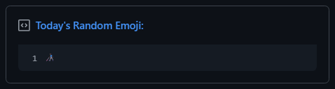
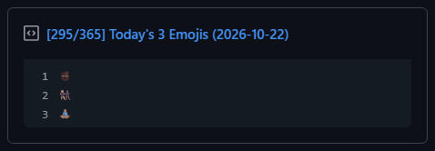
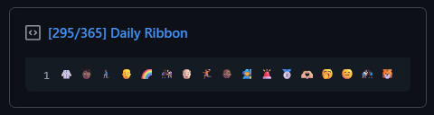
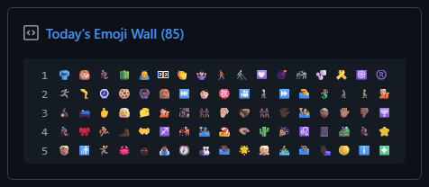
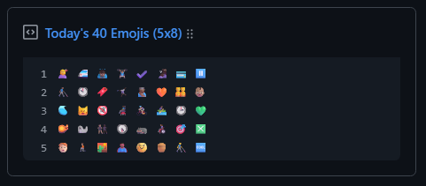
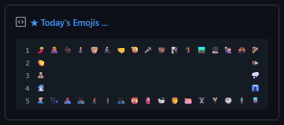

<!-- Daily Emoji Mix Repo Gist -->

# 🎲 Daily Emoji Mix 

A GitHub Actions workflow that automatically refreshes a public Gist with three random emojis daily. \
Pin the Gist to your GitHub profile, or fork this repository template to customize your own version!

---

## 📋 Gist Format

Each automated daily run updates the Gist description and `emojis.md`. Example description (title):

`[33/365] Today's Emojis (2006-02-02)`

The file contains one to three lines, with a specific number of random emojis. Example (content):

```markdown
💩
🍪
❤️
```

&nbsp;• The description and date use the UTC+03:00 calendar date and ordinal day of the year. \
&nbsp;• The file contains distinct random emojis selected from the Unicode pool, filtered according to [`config.json`](config.json). \
&nbsp;• The description is plain text; the workflow updates it and the file together each day.

---

## ⏰ Schedule & Time Zone

&nbsp;• The workflow runs daily at **00:00 UTC+03:00** by default. \
&nbsp;• **Timezone:** `Etc/GMT-3` (fixed UTC+03:00 offset, invariant to daylight saving time). \
&nbsp;• The date and emojis in the Gist update in sync with this timezone.

> **Scheduled-run timing:** GitHub may start scheduled workflows later than the specified time during periods of high Actions load, so 00:00 is the target time rather than a guaranteed start time. In public repositories, GitHub may disable scheduled workflows after 60 days without repository activity. If the schedule stops, check the repository's **Actions** settings and re-enable the workflow if needed.

---

## 🎨 Emoji Source

&nbsp;• The script fetches the latest official Unicode specification ([`emoji-test.txt`](https://www.unicode.org/Public/emoji/latest/emoji-test.txt)) directly on each run: \
&nbsp;• Filters for fully-qualified emoji sequences (including complex modifiers and skin-tone variants). \
&nbsp;• Excludes the Unicode Flags group for consistent cross-platform rendering across desktop, mobile, and web. \
&nbsp;• Filters by maximum Unicode version (`maxEmojiVersion: 15.1`) to ensure broad font support across all operating systems without missing-glyph tofu squares. \
&nbsp;• Requires zero extra `npm` dependencies because it runs directly using Node.js built-ins.

> [!NOTE]
> The emojis are selected randomly using Node.js cryptographic `randomInt`.

---

## 🚀 Setup Guide

&nbsp;1. **Create a Public Gist:** \
&nbsp;&nbsp;&nbsp;&nbsp;&nbsp;• Go to [gist.github.com](https://gist.github.com) and create a new **Public Gist**. \
&nbsp;&nbsp;&nbsp;&nbsp;&nbsp;• Enter **file name** `emojis.md`, any **description**, and any starter **content**; the workflow replaces both daily. \
&nbsp;&nbsp;&nbsp;&nbsp;&nbsp;• Copy the **Gist ID** from the URL (the alphanumeric hash at the end) and save it temporarily. \
&nbsp;2. **Fork or Template:** \
&nbsp;&nbsp;&nbsp;&nbsp;&nbsp;• **Fork** this repository or use it as a **template** (note that forks are public but templates can be private). \
&nbsp;3. **Configure Secrets & Variables:** \
&nbsp;&nbsp;&nbsp;&nbsp;&nbsp;• In your new repository, navigate to **Settings → Secrets and variables → Actions** and add the following: \
&nbsp;&nbsp;&nbsp;&nbsp;&nbsp;&nbsp;&nbsp;&nbsp;&nbsp;&nbsp;i. **Variable** `GIST_ID`: Enter your Gist ID (that you previously copied). \
&nbsp;&nbsp;&nbsp;&nbsp;&nbsp;&nbsp;&nbsp;&nbsp;&nbsp;&nbsp;ii. **Secret** `GH_TOKEN`: Create a [Fine-Grained Personal Access Token](https://github.com/settings/tokens?type=beta) with **Gists: Read and write** permission \
&nbsp;&nbsp;&nbsp;&nbsp;&nbsp;&nbsp;&nbsp;&nbsp;&nbsp;&nbsp;&nbsp;&nbsp;&nbsp;(Note: add a token name and description of your choice, make resource owner yourself, set an expi- \
&nbsp;&nbsp;&nbsp;&nbsp;&nbsp;&nbsp;&nbsp;&nbsp;&nbsp;&nbsp;&nbsp;&nbsp;&nbsp;-ration date, and choose public repos for the repository access - then save the value as the secret!) \
&nbsp;&nbsp;&nbsp;&nbsp;&nbsp;&nbsp;&nbsp;&nbsp;&nbsp;&nbsp;iii. Customize your own [`config.json`](config.json) file (optional - see examples below). \
&nbsp;4. **Trigger First Run:** \
&nbsp;&nbsp;&nbsp;&nbsp;&nbsp;• Go to the repository **Actions** tab, select **Update Gist**, and click **Run workflow** (only for the first time). \
&nbsp;5. **Pin to Profile:** \
&nbsp;&nbsp;&nbsp;&nbsp;&nbsp;• Visit your GitHub profile page, click **Customize your pins**, and select your Gist to be displayed!

---

## ⚙️ Configuration

### 1. Repository Configuration File (`config.json`)

You can customize the whole appearence directly in [`config.json`](config.json) without modifying any script code:

```json
{
  "gistTitle": "[{ordinal-date}] Today's Emojis ({iso-date})",
  "gistFilename": "emojis.md",
  "timeZone": "Etc/GMT-3",
  "emojiCount": "auto",
  "rows": 5,
  "columns": 17,
  "columnSeparator": " ",
  "rowSeparator": "\n",
  "randomize": false,
  "style": null,
  "middleSpaces": 53,
  "layout": null,
  "excludedGroups": [ "Flags" ],
  "excludedSubgroups": [ "family", "person-role" ],
  "emojiSourceUrl": "https://www.unicode.org/Public/emoji/latest/emoji-test.txt",
  "maxEmojiVersion": 15.1
}
```

| Property | Type | Default | Description |
| :--- | :---: | :---: | :--- |
| `gistTitle` | `string` | `"[... ({iso-date})]"` | Template or static string for Gist title/description. Supports placeholders: `{ordinal-date}`, `{iso-date}`, `{day-of-year}`, `{days-in-year}`, `{year}`, `{month}`, `{day}`, `{emoji-count}`, `{rows}`, and `{columns}`. |
| `gistFilename` | `string` | `"emojis.md"` | Target markdown file name inside the Gist. Can also be overridden by the `GIST_FILENAME` Actions variable. |
| `timeZone` | `string` | `"Etc/GMT-3"` | Target IANA timezone for calendar date and ordinal day calculation (e.g. `"UTC"`, `"Europe/Athens"`). Can also be overridden by `TIMEZONE`. |
| `emojiCount` | `number \| "auto"` | `51` / `"auto"` | Total number of random emojis to pick and render, or set to `"auto"` when using `rows` and `columns`. Overridable by `EMOJI_COUNT`. |
| `rows` | `number \| [min, max]` | `3` | Number of rows, or a random range array `[min, max]` (e.g. `[1, 5]`) to pick rows randomly each day. |
| `columns` | `number \| [min, max]` | `17` | Number of columns, or a random range array `[min, max]` (e.g. `[1, 17]`) to pick columns randomly each day. |
| `columnSeparator` | `string` | `" "` | Delimiter between emojis within the same row (e.g. `"   "` for wider spacing). |
| `rowSeparator` | `string` | `"\n"` | Delimiter between rows. |
| `randomize` | `boolean` | `false` | *(Optional)* Set to `true` to automatically randomize both rows (`[1, 5]`) and columns (`[1, 17]`) daily. |
| `style` | `string` | `null` | *(Optional)* Set to `"box"` to automatically format emojis into a hollow perimeter frame/box. |
| `middleSpaces` | `number` | `53` | *(Optional)* Number of space characters between left and right border emojis in `"box"` style (set to `53` for exact 17-column desktop alignment). |
| `layout` | `number[]` | `null` | *(Optional)* Custom row distribution array specifying the exact count of emojis on each row (e.g. `[5, 0, 0, 0, 1]`). |
| `excludedGroups` | `string[]` | `["Flags"]` | Array of Unicode emoji group names to exclude from the pool (case-insensitive). |
| `excludedSubgroups` | `string[]` | `["family", "person-role"]` | Array of Unicode emoji subgroup names to exclude from the pool (case-insensitive). |
| `emojiSourceUrl` | `string` | Unicode `latest` | URL of the official Unicode emoji specification data file (defaults to `emoji-test.txt`). |
| `maxEmojiVersion` | `number` | `15.1` | Maximum Unicode Emoji release version to allow. Filters out unreleased emojis (16.0–18.0) that render as tofu (`▯`). Overridable by `MAX_EMOJI_VERSION`, or set to `null` to disable filtering. |

### 2. Actions Variables & Secrets

| Name | Type | Required | Default | Description |
| :---: | :---: | :---: | :---: | :---: |
| `GH_TOKEN` | Actions secret | Yes | — | Fine-Grained Personal-Access-Token with Gists Read/Write Permission. |
| `GIST_ID` | Actions variable | Yes | — | ID of the target Gist to update. |
| `JSON` | Repository file | No | Built-in defaults | Optional configuration file for customization. |

> [!TIP]
> To customize the daily emojis, categories, layout, or title, simply edit [`config.json`](config.json) (or configure Actions variables). No code changes to `updater.mjs` needed!

---

## 🎨 Presets & Layout Examples

Explore these ready-to-use presets showcasing different visual layouts on a pinned desktop GitHub Gist. \
You can copy any snippet directly into [`config.json`](config.json), or find the ready `.json` files in the [`examples/`](examples/) folder:

> [!WARNING]
> **Cross-Device & Display Differences:** \
> The pinned Gist layouts shown below are optimized for desktop browser viewports (where profile cards cleanly fit up to 5 rows and 17 columns). On mobile screens, narrower viewports, or different operating systems (macOS, iOS, Android, Linux), native emoji fonts and container widths vary, which may cause wide layouts to wrap onto additional lines or show slight alignment differences.

> [!TIP]
> **Tofu Emojis (`▯`):** \
> If you notice blank or rectangular tofu symbols, it means your operating system's font does not support the latest Unicode draft emojis. By default, `maxEmojiVersion` caps the pool at `15.1`, guaranteeing that every chosen emoji renders crisply on modern Windows, macOS, iOS, Android, and Linux systems.

### 1. Default (Single Emoji)
A single focal emoji badge updated daily.
<br>



```json
{
  "gistTitle": "Today's Random Emoji:",
  "rows": 1,
  "columns": 1
}
```

### 2. Vertical Stack (3 Emojis)
The classic 3-emoji vertical stack featuring the day of the year and ISO date.
<br>



```json
{
  "gistTitle": "[{ordinal-date}] Today's {emoji-count} Emojis ({iso-date})",
  "rows": 3,
  "columns": 1
}
```

### 3. Daily Ribbon (1×17 Banner)
A clean, horizontal banner of 17 emojis spanning across the pinned card.
<br>



```json
{
  "gistTitle": "[{ordinal-date}] Daily Ribbon",
  "rows": 1,
  "columns": 17
}
```

### 4. Emoji Wall (5×17 Dense Mosaic)
A dense wall of 85 emojis filling the maximum desktop pinned card viewport.
<br>



```json
{
  "gistTitle": "Today's Emoji Wall ({emoji-count})",
  "rows": 5,
  "columns": 17
}
```

### 5. The Daily Surprise (Randomized Dimensions)
Randomizes both row and column count for an unpredictable new layout each day!
<br>



```json
{
  "gistTitle": "Today's {emoji-count} Emojis ({rows}x{columns}):",
  "randomize": true
}
```

### Bonus. Hollow Box (5×17 Perimeter Frame)
Surrounds the card with an emoji border and a hollow interior, calibrated for exact monospace alignment.
<br>



```json
{
  "gistTitle": "★ Today's Emojis ...",
  "rows": 5,
  "columns": 17,
  "style": "box",
  "middleSpaces": 53
}
```

---

## 🔒 Security Best Practices

&nbsp;• **Public Visibility:** Note that public Gists and their revision histories are visible to everyone. \
&nbsp;• **Store as Secret:** Never hardcode or commit tokens to the repository. \
&nbsp;• **Strict Token Scoping:** Grant permissions only for **Gists (Read & Write)**. \
&nbsp;&nbsp;Never grant repository, workflow, or administrative scopes.

---

## 📄 License

This project is licensed under the [MIT License](LICENSE). \
Emoji data is fetched from Unicode at runtime and remains subject to [Unicode Terms of Use](https://www.unicode.org/terms_of_use.html).

<!-- Daily Emoji Mix Repo Gist -->